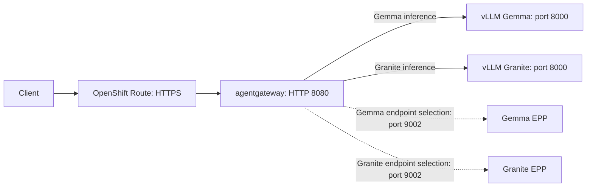

# Serving Multiple LLMs on Red Hat OpenShift

This repository contains manifests for serving large language models (LLMs) with llm-d, vLLM, and Gateway API on Red Hat OpenShift. A shared agentgateway routes chat requests by the JSON `model` field. Embeddings use a separate Text Embeddings Inference (TEI) deployment.

The repository builds on [Run Model-as-a-Service for Multiple LLMs on OpenShift](https://developers.redhat.com/articles/2026/03/24/run-model-service-multiple-llms-openshift). The configuration described here reflects the manifests and the deployment verified on 28 October 2026.

## Verified Deployment

Gemma 4 31B and Granite 4.1 30B FP8 each have one ready model-server replica and one ready endpoint picker (EPP). Both return HTTP 200 through the external Gateway. Other installed model deployments and their EPPs are scaled to zero at the time of verification.

| Model | Model-service release | Container image | PVC capacity | Tool parser |
| --- | --- | --- | --- | --- |
| `RedHatAI/gemma-4-31B-it-FP8-block` | `ms-gemma-4-31b` | `vllm/vllm-openai:gemma4` | 45 GiB | `gemma4` |
| `ibm-granite/granite-4.1-30b-fp8` | `ms-granite-41-30b-fp8` | `vllm/vllm-openai:v0.19.0` | 60 GiB | `granite4` |

Both releases use the `llm-d-modelservice` chart at `v0.4.15`. Their InferencePool releases use chart `v1.3.0`. The verified cluster runs OpenShift `4.20.13` with NVIDIA H200 GPUs and the `lvms-vg1` storage class.

## Request Routing

The deployment uses llm-d Gateway Mode. The Gateway selects a model pool, consults that pool's EPP, and forwards the request to the selected vLLM pod.



Solid arrows show inference traffic. Dotted arrows show endpoint-picker calls. The routing policy, HTTPRoutes, and InferencePools configure these paths.

The shared resources run in `agentgateway-system`. Model servers, InferencePools, EPPs, and HTTPRoutes run in `llm-d`.

| Resource | Name or setting | Purpose |
| --- | --- | --- |
| Gateway | `inference-gateway` | Uses GatewayClass `agentgateway-v2` and listens on HTTP port `8080` |
| OpenShift Route | `inference-gateway` | Terminates TLS at the OpenShift router and forwards to the Gateway service |
| AgentgatewayPolicy | `bbr` | Sets `X-Gateway-Base-Model-Name` from the request body's `model` field before routing |
| HTTPRoute | One per model pool | Matches the model header and references the InferencePool |
| InferencePool | `vllm-<model-key>` | Selects model pods by their `app` label and targets port `8000` |
| EPP | `vllm-<model-key>-epp` | Selects an endpoint for its model pool; the picker service uses port `9002` |

Both active model servers use the chart's decode deployment for prefill and decode in one vLLM process. Their values set `prefill.create: false` and `routing.proxy.enabled: false`. They do not use the llm-d routing sidecar or transfer key-value (KV) cache between separate prefill and decode pods.

HTTPRoutes must reference Gateway `inference-gateway` in namespace `agentgateway-system`. The routing policy must contain the exact served model ID, including capitalization.

## Repository Models

The following directories contain model configurations. A manifest directory or routing-policy entry does not indicate that a model is running.

| Model | Manifest directory |
| --- | --- |
| `google/gemma-4-26B-A4B-it` | [Gemma 4 26B](manifests/gemma-4-26b-a4b-google/) |
| `RedHatAI/gemma-4-26B-A4B-it-FP8-Dynamic` | [Gemma 4 26B FP8](manifests/gemma-4-26b-a4b/) |
| `RedHatAI/gemma-4-31B-it-FP8-block` | [Gemma 4 31B FP8](manifests/gemma-4-31b/) |
| `ibm-granite/granite-4.0-h-small` | [Granite 4.0](manifests/granite-4-h-small/) |
| `ibm-granite/granite-4.1-30b-fp8` | [Granite 4.1 30B FP8](manifests/granite-41-30b-fp8/) |
| `ibm-granite/granite-4.1-8b-fp8` | [Granite 4.1 8B FP8](manifests/granite-41-8b-fp8/) |
| `Jackrong/Qwen3.5-27B-Claude-4.6-Opus-Reasoning-Distilled` | [Qwen 3.5 27B](manifests/qwen35-27b-distilled/) |
| `Qwen/Qwen3.5-35B-A3B` | [Qwen 3.5 35B](manifests/qwen35-35b-a3b/) |
| `Qwen/Qwen3.5-9B` | [Qwen 3.5 9B](manifests/qwen35-9b/) |
| `Qwen/Qwen3-Next-80B-A3B-Thinking` | [Qwen 3 Next 80B](manifests/qwen3-next-80b/) |
| `sentence-transformers/all-mpnet-base-v2` | [MPNet embeddings with TEI](manifests/all-mpnet-base-v2/) |

Model-specific instructions can describe older charts; the procedure below applies to the two verified active models.

## Deployment Prerequisites

Run commands from the repository root. Before deploying, verify that your cluster provides these components:

- GPU Operator, NVIDIA drivers, and enough allocatable GPU resources for the selected models
- A default storage class for the persistent volume claims (PVCs), which request ReadWriteOnce (RWO) access
- Gateway API and Gateway API Inference Extension custom resource definitions
- An installed agentgateway controller, GatewayClass `agentgateway-v2`, and the `AgentgatewayPolicy` custom resource definition
- The `oc`, Helm, `curl`, and `jq` command-line tools and access to the required model repositories

This repository configures the serving resources. It does not install the GPU Operator or the agentgateway control plane. Refer to the [llm-d gateway documentation](https://llm-d.ai/) for provider installation instructions that match your cluster.

Set the namespace and chart versions:

```bash
export NAMESPACE=llm-d
export MODEL_SERVER=vllm
export IGW_CHART_VERSION=v1.3.0
export MODEL_SERVICE_CHART_VERSION=v0.4.15
```

Inspect the cluster and configure the model-service chart repository:

```bash
oc get nodes -o json | jq '.items[] | {name: .metadata.name, gpuCapacity: .status.capacity["nvidia.com/gpu"], gpuAllocatable: .status.allocatable["nvidia.com/gpu"]}'
oc describe nodes
oc get storageclass
oc get gatewayclass agentgateway-v2
oc get crd inferencepools.inference.networking.k8s.io agentgatewaypolicies.agentgateway.dev
helm repo add llm-d-modelservice https://llm-d-incubation.github.io/llm-d-modelservice/
helm repo update llm-d-modelservice
```

The node's allocatable GPU count describes scheduling capacity. Use the allocated-resource information from `oc describe nodes` to check existing requests before starting additional models.

## Deploying the Two Active Models

The following procedure creates or updates serving resources. For an existing installation with complete model files, retain its PVCs and skip the download steps.

### Prepare the Namespace and Model Access

Create the namespace and token secret if they do not exist:

```bash
oc create namespace "${NAMESPACE}"
read -r -s -p 'Hugging Face token: ' HF_TOKEN
oc create secret generic llm-d-hf-token \
--from-literal="HF_TOKEN=${HF_TOKEN}" \
--namespace "${NAMESPACE}"
unset HF_TOKEN
```

### Configure the Shared Gateway

Apply the Gateway resources:

```bash
oc apply -f manifests/shared/gateway.yaml
oc apply -f manifests/shared/scc-binding.yaml
oc rollout status deployment/inference-gateway -n agentgateway-system
oc apply -f manifests/shared/agentgateway-policy.yaml
oc apply -f manifests/shared/route.yaml
```

The SCC role binding grants `nonroot-v2` to the Gateway's `inference-gateway` service account. It does not grant that constraint to model servers. Both verified model pods run under `restricted-v2`.

### Download Model Artifacts

For a new installation, create the PVCs and download pods:

```bash
oc apply -f manifests/gemma-4-31b/pvc.yaml
oc apply -f manifests/granite-41-30b-fp8/pvc.yaml
oc apply -f manifests/gemma-4-31b/download.yaml
oc apply -f manifests/granite-41-30b-fp8/download.yaml
```

Wait for both download pods to become ready, then remove them:

```bash
oc wait --for=condition=Ready pod/download-gemma-4-31b \
-n "${NAMESPACE}" --timeout=7200s
oc wait --for=condition=Ready pod/download-granite-41-30b-fp8 \
-n "${NAMESPACE}" --timeout=7200s
oc delete pod download-gemma-4-31b download-granite-41-30b-fp8 -n "${NAMESPACE}"
```

The download runs in an init container. The pod becomes ready after the download finishes and its pause container starts. Removing the download pod releases its volume mount before the model server starts.

### Configure Model Pools

Install or update the two InferencePool releases:

```bash
helm upgrade --install vllm-gemma-4-31b \
--set inferencePool.modelServers.matchLabels.app=vllm-gemma-4-31b \
--set inferencePool.modelServerType=vllm \
--set provider.name=none \
--set experimentalHttpRoute.enabled=true \
--set experimentalHttpRoute.baseModel=RedHatAI/gemma-4-31B-it-FP8-block \
--version "${IGW_CHART_VERSION}" --namespace "${NAMESPACE}" \
oci://us-central1-docker.pkg.dev/k8s-staging-images/gateway-api-inference-extension/charts/inferencepool

helm upgrade --install vllm-granite-41-30b-fp8 \
--set inferencePool.modelServers.matchLabels.app=vllm-granite-41-30b-fp8 \
--set inferencePool.modelServerType=vllm \
--set provider.name=none \
--set experimentalHttpRoute.enabled=true \
--set experimentalHttpRoute.baseModel=ibm-granite/granite-4.1-30b-fp8 \
--version "${IGW_CHART_VERSION}" --namespace "${NAMESPACE}" \
oci://us-central1-docker.pkg.dev/k8s-staging-images/gateway-api-inference-extension/charts/inferencepool
```

Connect both generated HTTPRoutes to the shared Gateway:

```bash
oc patch httproute vllm-gemma-4-31b -n "${NAMESPACE}" --type=merge \
-p '{"spec":{"parentRefs":[{"group":"gateway.networking.k8s.io","kind":"Gateway","name":"inference-gateway","namespace":"agentgateway-system"}]}}'
oc patch httproute vllm-granite-41-30b-fp8 -n "${NAMESPACE}" --type=merge \
-p '{"spec":{"parentRefs":[{"group":"gateway.networking.k8s.io","kind":"Gateway","name":"inference-gateway","namespace":"agentgateway-system"}]}}'
```

Recheck these references after an InferencePool Helm upgrade because the chart generates the HTTPRoutes. The shared routing-policy manifest already contains both model IDs.

### Start the Model Servers

Install or update the model-service releases:

```bash
helm upgrade --install ms-gemma-4-31b llm-d-modelservice/llm-d-modelservice \
--version "${MODEL_SERVICE_CHART_VERSION}" \
-f manifests/gemma-4-31b/values.yaml -n "${NAMESPACE}"
helm upgrade --install ms-granite-41-30b-fp8 llm-d-modelservice/llm-d-modelservice \
--version "${MODEL_SERVICE_CHART_VERSION}" \
-f manifests/granite-41-30b-fp8/values.yaml -n "${NAMESPACE}"
```

The values files request one decode replica each and configure the following behavior:

- A `Recreate` deployment strategy prevents overlap between old and replacement model-server pods.
- The `modelArtifacts.readOnly: false` setting supports OpenShift volume ownership and SELinux setup on the model PVCs.
- The pod security context sets `fsGroupChangePolicy: OnRootMismatch`.
- The container environment sets `HOME=/tmp` and `HF_HOME=/tmp/huggingface` for writable caches.
- A readiness probe checks `/health` on port `8000` every 10 seconds with a five-second request timeout.

Loading, compilation, and CUDA graph capture can take several minutes. Readiness failures keep an initializing pod out of service; they do not restart its container. These values do not configure liveness or startup probes.

## Verifying Inference

Inspect both model servers, both EPPs, and the routing resources:

```bash
oc get deployments,pods -n "${NAMESPACE}"
oc get inferencepool,httproute -n "${NAMESPACE}"
oc get gateway inference-gateway -n agentgateway-system -o yaml
oc get agentgatewaypolicy bbr -n agentgateway-system -o yaml
```

Check that the Gateway reports `Accepted=True` and `Programmed=True`, both HTTPRoutes report `Accepted=True` and `ResolvedRefs=True`, and the policy reports `Accepted=True` and `Attached=True`.

### Discover the Gateway Hostname

Read the hostname from the named OpenShift Route:

```bash
export GATEWAY_URL=$(oc get route inference-gateway \
-n agentgateway-system -o jsonpath='{.spec.host}')
printf 'https://%s\n' "${GATEWAY_URL}"
```

Use the returned value in requests. Do not replace the cluster domain with `apps.ocp4.redhat.com`. That hostname does not resolve in the verified environment.

### Send Chat Requests

Test Granite through the external Gateway:

```bash
curl -sS --fail-with-body "https://${GATEWAY_URL}/v1/chat/completions" \
-H 'Content-Type: application/json' \
-d '{"model":"ibm-granite/granite-4.1-30b-fp8","messages":[{"role":"user","content":"Hello"}],"max_tokens":100}' \
| jq .
```

Test Gemma through the same endpoint:

```bash
curl -sS --fail-with-body "https://${GATEWAY_URL}/v1/chat/completions" \
-H 'Content-Type: application/json' \
-d '{"model":"RedHatAI/gemma-4-31B-it-FP8-block","messages":[{"role":"user","content":"Hello"}],"max_tokens":100}' \
| jq .
```

A successful request returns HTTP 200 and a `choices` array. The `-sS` options suppress the progress meter while preserving connection and DNS errors. Use `set -o pipefail` in automation so that a successful `jq` process does not hide a failed `curl` command.

### Inspect Model Registration

The current Gateway routing policy requires a JSON body with a `model` field. It does not provide a model-list route for `GET /v1/models`.

Inspect configured model routes:

```bash
oc get httproute -n "${NAMESPACE}" \
-o custom-columns='POOL:.metadata.name,MODEL:.spec.rules[0].matches[0].headers[0].value'
```

Query a running server directly when you need its model metadata:

```bash
oc exec deployment/ms-granite-41-30b-fp8-llm-d-modelservice-decode \
-n "${NAMESPACE}" -c vllm -- curl -sS --fail-with-body http://localhost:8000/v1/models
```

## Scaling Model Servers and Endpoint Pickers

Model-server and EPP deployments scale independently. To start both verified models, set all four deployments to one replica:

```bash
oc scale deployment \
ms-gemma-4-31b-llm-d-modelservice-decode \
ms-granite-41-30b-fp8-llm-d-modelservice-decode \
vllm-gemma-4-31b-epp \
vllm-granite-41-30b-fp8-epp \
--replicas=1 -n "${NAMESPACE}"
```

To stop these model servers and their EPPs, run the same command with `--replicas=0`. Scaling preserves PVCs, Helm releases, routing resources, and downloaded model files. A Helm upgrade can restore replica counts from chart values, so record persistent scale changes in the relevant release configuration.

## Troubleshooting Serving Requests

Use the following checks to distinguish connection, routing, and model-startup failures.

| Symptom | Check and recovery |
| --- | --- |
| `Could not resolve host` | Discover the hostname from Route `inference-gateway` in `agentgateway-system`. Use `curl -sS` to display errors. |
| HTTP 404 or no matching route | Check the exact model ID, policy mapping, routing header, and HTTPRoute parent namespace. |
| No available model endpoint | Check the model pod's readiness, the InferencePool selector, and the model's EPP deployment. The pool uses `FailClose` when the picker is unavailable. |
| Permission errors under the home directory | Verify the container's `HOME` and `HF_HOME` values and inspect vLLM logs. |
| Pod remains unready during loading | Inspect startup logs and events. Model initialization can take several minutes; readiness failures do not trigger restarts. |
| Volume mount or attachment failure | Inspect pod events and PVC status. Remove a completed download pod before starting its model server. |

Inspect the Granite server's logs and routing resources:

```bash
oc logs deployment/ms-granite-41-30b-fp8-llm-d-modelservice-decode \
-n "${NAMESPACE}" -c vllm --tail=100
oc describe pods -n "${NAMESPACE}" -l app=vllm-granite-41-30b-fp8
oc get inferencepool vllm-granite-41-30b-fp8 -n "${NAMESPACE}" -o yaml
oc get httproute vllm-granite-41-30b-fp8 -n "${NAMESPACE}" -o yaml
oc get pvc -n "${NAMESPACE}"
```

### Recover an Existing Read-Only Mount

The migration encountered `chmod 2777 failed` and `read-only file system` during volume setup. The existing mounts remained read-only after configuration changes. Both models recovered with their original PVCs after a complete unmount and remount.

For an affected deployment, use this recovery sequence:

1. Verify that chart `v0.4.15` renders `modelArtifacts.readOnly: false`, strategy `Recreate`, and `fsGroupChangePolicy: OnRootMismatch` from its values file.
2. Scale the affected model server to zero.
3. Wait for its old pods to terminate and confirm that the old volume mounts are gone.
4. Scale the model server to one and inspect its events, mount options, and readiness.
5. Verify inference through the external Gateway.

Both recovered PVCs mount with `rw`, and both model pods use `restricted-v2`. This recovery did not require deleting PVCs or changing model-server SCC permissions. PVC recreation removes downloaded model data; use it only when necessary and authorized.

## Selecting a vLLM Image

Check the actual GPU driver and container CUDA runtime before selecting an image. Consult the exact model's [official recipe](https://recipes.vllm.ai/), then inspect the published image metadata. A newer Helm chart does not update the container image declared in a values file.

The compatibility review on 28 October 2026 recorded the following results:

| Item | Verified result |
| --- | --- |
| NVIDIA H200 driver | `575.57.08`; `nvidia-smi` reports CUDA support through `12.9` |
| Running Granite runtime | PyTorch `2.10.0+cu129`, CUDA `12.9` |
| Running Gemma version | `0.19.1.dev6+g6d4a8e6d2` from the `:gemma4` image |
| Upgrade candidate | `vllm/vllm-openai:v0.32.0-cu129`, containing CUDA `12.9.1` |
| Default `v0.32.0` image | Contains CUDA `13.0.2` |

The [Gemma FP8-block recipe](https://recipes.vllm.ai/RedHatAI/gemma-4-31B-it-FP8-block.json) lists minimum vLLM `0.19.1` and recommends `latest`. Its generated command also configures FP8 KV cache, a tool chat template, and reasoning parsing. Validate those behavior changes before adopting them.

The [recipe catalog](https://recipes.vllm.ai/models.json) has no entry for Granite 4.1 30B FP8 at the time of review. Both verified models retain their working images. The `v0.32.0-cu129` image is an upgrade candidate; startup and inference with these checkpoints have not been validated on that image.

## Removing Model Services

To remove the two model-server releases while retaining model files and routing resources, run:

```bash
helm uninstall ms-gemma-4-31b ms-granite-41-30b-fp8 -n "${NAMESPACE}"
```

To remove their model pools and EPPs as well, run:

```bash
helm uninstall vllm-gemma-4-31b vllm-granite-41-30b-fp8 -n "${NAMESPACE}"
```

These commands do not delete the separately created model PVCs. Shared Gateway resources serve other configured models; remove them only when the shared serving endpoint is no longer needed.

## Embedding Service

The `sentence-transformers/all-mpnet-base-v2` configuration uses Hugging Face TEI on CPU. It has its own OpenShift Route and does not use the chat-routing policy. Refer to the [embedding deployment instructions](manifests/all-mpnet-base-v2/README.md) for its setup and request examples.

## Project References

Use these resources for component documentation and model recipes:

- [llm-d documentation](https://llm-d.ai/)
- [Model-service chart](https://llm-d-incubation.github.io/llm-d-modelservice/)
- [Gateway API Inference Extension](https://github.com/kubernetes-sigs/gateway-api-inference-extension)
- [vLLM documentation](https://docs.vllm.ai/)
- [vLLM model recipes](https://recipes.vllm.ai/)

## Contribution and Licensing

Test changes in a nonproduction environment and document the models and request paths that you verify. Refer to [AGENTS.md](AGENTS.md) for repository instructions. Individual serving components and model checkpoints retain their own licenses.
